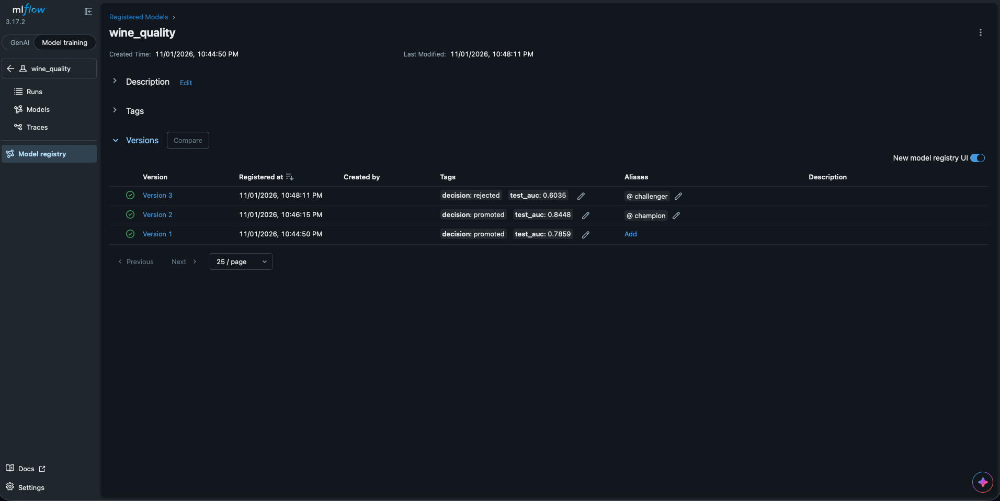
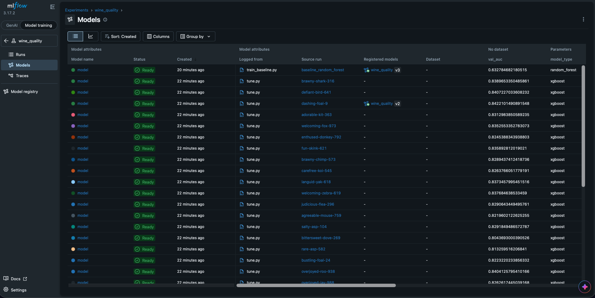

# DADS 7305 Lab 3: MLflow Tracking with a Champion-Challenger Promotion Gate

A wine-quality classifier tracked with MLflow. Each model is trained, logged and registered, but a new model only replaces the current one if it beats it on the same held-out test set. The winning model is then used for batch scoring and served over a local web API.

This project is based on Prof. Ramin Mohammadi's [MLOps Experiment_Tracking_Labs/Mlflow_Labs/Lab2](https://github.com/raminmohammadi/MLOps/tree/main/Labs/Experiment_Tracking_Labs/Mlflow_Labs/Lab2). His original files are kept in `original/`. The changes I made are listed in [Changes from the original lab](#changes-from-the-original-lab).

**Author:** Connor Rivera · DADS 7305 Machine Learning Operations · Fall 2026



## What the project does

```
train_baseline ─┐
                ├─> promote (the gate) ─┬─ better:  moves @champion ─> batch_score, model server
tune ───────────┘                       └─ worse:   stays @challenger, champion unchanged
```

| Script | What it does |
|---|---|
| `src/data.py` | Loads the wines, removes duplicates, and makes the same 60/20/20 split every run |
| `src/train_baseline.py` | Trains a random forest, logs it to MLflow, and marks it as a candidate |
| `src/tune.py` | Runs a 32-trial XGBoost search, logs every trial, and marks the best as a candidate |
| `src/promote.py` | **The gate.** Registers the newest candidate and promotes it only if it beats the champion |
| `src/batch_score.py` | Scores 1,064 wines with the current champion and saves a CSV |
| `src/check_server.py` | Sends 3 wines to the running model server and prints the results |
| `src/settings.py` | Names shared by every script |

## Changes from the original lab

| # | Change | What it does | Why |
|---|---|---|---|
| 1 | **Promotion gate** (`src/promote.py`) | A candidate must beat the champion's test AUC by at least 0.005 (`MIN_IMPROVEMENT`). Otherwise it is rejected and the champion stays. | The original promoted every new model without checking it |
| 2 | **Aliases instead of stages** | Uses `@champion` and `@challenger` | The original's `Production` and `Archived` stages are deprecated in MLflow |
| 3 | **Audit trail** | Saves the decision and test AUC on the run and on the model version | Anyone can see why a version was promoted or rejected |
| 4 | **Fair scoring** | Training is judged on validation data. Only the gate uses test data. | The original scored the baseline on test and XGBoost on validation, then ranked them together |
| 5 | **Duplicate removal** | Removes 1,177 exact duplicate rows before splitting, and stratifies the splits | The same wine could land in both train and test. On a 100-tree forest, test AUC fell from 0.905 to 0.846 once duplicates were removed. |
| 6 | **Spark removed** | Tuning uses local Hyperopt `Trials`, and batch scoring uses pandas | Spark needs Java and a cluster-style setup, which this lab does not need |
| 7 | **Scripts instead of a notebook** | Every step is one command, in a fixed order | The notebook relied on Databricks features and blocked on `!mlflow ui` |
| 8 | **Local SQLite tracking** | Runs and the registry are stored in `mlflow.db` | The registry works locally with no server |
| 9 | **Updated, pinned versions** | All packages are pinned for Python 3.13. The search uses depth 3 to 12, 32 trials and up to 500 rounds (originally 4 to 100, 96 and 1,000). | `xgboost==1.7.6` is out of date, and a smaller search finishes in about a minute |

## Project structure

```
.
├── src/                 # All lab code (see the table above)
├── data/                # Red and white wine CSVs
├── assets/              # Screenshots used in this README
├── original/            # Prof. Mohammadi's original files, unchanged
├── requirements.txt     # Pinned Python packages
└── README.md
```

These are created when you run the lab and are not in the repo: `.venv/`, `mlflow.db`, `mlruns/` and `outputs/`.

## What you need to install

| Software | Version tested | Notes |
|---|---|---|
| [Python](https://www.python.org/downloads/) | 3.13.5 | Must be 3.12 or newer |
| [Git](https://git-scm.com/downloads) | any | To download this repo |
| libomp (Mac only) | any | Required by XGBoost. Install [Homebrew](https://brew.sh), then run `brew install libomp`. |
| A web browser | any | To view the MLflow page |

This lab was tested on macOS (Apple Silicon). Python packages are installed in step 3 below:

| Package | Version |
|---|---|
| mlflow | 3.17.2 |
| xgboost | 3.4.1 |
| hyperopt | 0.3.0 |
| scikit-learn | 1.9.1 |
| pandas | 3.1.0 |
| numpy | 2.5.4 |
| seaborn | 0.13.2 |

## Setup

**1. Download the repo and go into it**

```bash
git clone https://github.com/connor-rivera/dads7305-lab3-mlflow.git
cd dads7305-lab3-mlflow
```

**2. Create and activate a virtual environment**

```bash
python3 -m venv .venv
source .venv/bin/activate
```

On Windows, run `.venv\Scripts\activate` instead. Run `python --version` to confirm you have 3.12 or newer.

**3. Install the packages.** This can take a few minutes.

```bash
pip install -r requirements.txt
```

## Running the lab

Run every command from the repo folder with the environment active. Run the steps in order, because each one builds on the last.

**1. Train the baseline and make it the first champion**

```bash
python -m src.train_baseline
python -m src.promote
```

**2. Tune XGBoost and send the winner to the gate.** The search takes about a minute.

```bash
python -m src.tune
python -m src.promote
```

**3. Train a deliberately weak model.** It uses only one tree, to prove the gate blocks it.

```bash
python -m src.train_baseline --n-trees 1
python -m src.promote
```

**4. Score a batch of wines with the champion**

```bash
python -m src.batch_score
```

**5. Serve the champion.** The server keeps running, so leave this terminal open.

```bash
export MLFLOW_TRACKING_URI=sqlite:///mlflow.db
mlflow models serve -m "models:/wine_quality@champion" -p 5002 --env-manager local
```

Wait for `Uvicorn running on http://127.0.0.1:5002`. Then open a second terminal in the repo folder:

```bash
source .venv/bin/activate
python -m src.check_server
```

Press `Ctrl+C` in the first terminal to stop the server, then run `unset MLFLOW_TRACKING_URI`.

**6. View everything in MLflow**

```bash
mlflow ui --backend-store-uri sqlite:///mlflow.db --port 5001
```

Open <http://localhost:5001> and click **Model training** at the top left. Open the `wine_quality` experiment for runs and models, or **Model registry** for versions and aliases. Press `Ctrl+C` to stop it.

## What a successful run looks like

Yellow warnings are expected and harmless, including ones about integer columns, CloudPickle, type hints and `no artifacts at artifact path 'model'`. Look for these lines:

| Step | Expected output |
|---|---|
| 1. Baseline | `Validation AUC: 0.7896` |
| 1. Gate | `Candidate test AUC: 0.7859`, then `Decision: PROMOTED (no champion yet)` |
| 2. Tuning | `Best validation AUC: 0.8422` |
| 2. Gate | `Candidate test AUC: 0.8448`, then `Decision: PROMOTED (gain +0.0590, needed +0.0050)` |
| 3. Weak model | `Validation AUC: 0.6328` |
| 3. Gate | `Candidate test AUC: 0.6035`, then `Decision: REJECTED (gain -0.2413, needed +0.0050)` |
| 4. Batch scoring | `Scored 1064 wines`, then `Saved to outputs/batch_scores.csv` |
| 5. Server check | `{'predictions': [0.00333..., 0.04622..., 0.00174...]}` |

Each prediction is the chance that a wine is good, meaning a quality score of 7 or higher. Numbers may differ slightly on other systems.

In the Model registry, `@champion` should be on version 2, and `@challenger` should be on the rejected version 3, as in the image at the top of this README.

Every tracked model and its validation AUC:



## Starting over

This deletes all runs and registered models:

```bash
rm -rf mlflow.db mlruns outputs
```

## Troubleshooting

| Problem | Fix |
|---|---|
| `XGBoost Library could not be loaded` on a Mac | Run `brew install libomp` |
| `ModuleNotFoundError: No module named 'src'` | Run commands from the repo folder, using `python -m src.name` |
| `No new candidate to review.` | The gate has already reviewed the newest model. Train a new one first. |
| `Address already in use` | Another program is using the port. Stop it, or change the port number. |
| `ConnectionError` from `check_server` | The server isn't running yet. Wait for the `Uvicorn running` line. |
| The MLflow page looks empty | Click **Model training** at the top left. The GenAI view does not show these runs. |

## Known limitations

- The gate reuses the same test set every time. Over many rounds, a model could look better than it is by luck. A real system would use fresh data for each decision.
- Passing on test AUC alone does not check speed, fairness or stability.
- The batch step scores the test wines as a stand-in for new data.
- `mlflow.db` and `mlruns/` are local files. A team would use a shared tracking server.